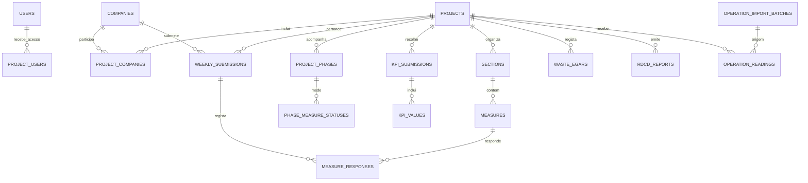

# Exemplo de estrutura da base de dados — STAND

Este é um mapa de leitura para o DBA e equipa IT. O esquema instalável encontra-se em `drizzle/0000_stand_schema_baseline.sql`; é a fonte técnica completa. O exemplo abaixo não representa dados reais e não contém linhas de negócio.

## Dimensão do esquema de fresh start

| Elemento | Quantidade | Nota |
| --- | ---: | --- |
| Tabelas | 59 | Estrutura completa do estado final da aplicação. |
| Migrações para uma base nova | 1 | `0000_stand_schema_baseline`. |
| Dados incluídos | 0 | Sem utilizadores, empresas, projetos, fichas, ficheiros, telemetria ou demo. |
| Relações físicas `FOREIGN KEY` | 0 | As ligações são validadas pelo domínio/API; índices e `UNIQUE` constam na baseline. |
| Credenciais | 0 | Apenas em cofre e variáveis protegidas do ambiente. |

## Mapa lógico

## Grupos de tabelas

| Domínio | Tabelas |
| --- | --- |
| Identidade e governação | `users`, `invitations`, `project_users`, `companies`, `project_companies`, `partner_access_profiles`, `partner_company_profiles`, `eep_requests`, `eep_request_users`, `app_settings`, `audit_log`, `deletion_logs`, `user_feedback`, `notification_recipients` |
| Projeto e catálogos | `projects`, `sections`, `measures`, `project_phases`, `project_phase_updates`, `phase_measure_statuses`, `phase_measure_updates`, `phase_evidence` |
| Fichas semanais de construção | `weekly_submissions`, `measure_responses`, `measure_reviews`, `review_comments`, `evidence_images`, `evidence_files`, `historical_pdfs`, `weeks_without_work` |
| KPI | `kpi_metrics`, `kpi_targets`, `kpi_submissions`, `kpi_values`, `kpi_submission_changes`, `kpi_incidents` |
| Resíduos e reporting | `waste_subprojects`, `waste_egars`, `rdcd_reports` |
| Planos e calendário APA | `monitoring_plans`, `monitoring_plan_assignments`, `monitoring_plan_updates`, `monitoring_plan_attachments`, `calendar_events`, `calendar_reminder_logs`, `apa_reporting_cycles`, `apa_reporting_cycle_plans` |
| Biblioteca documental | `document_library`, `document_library_projects` |
| Operação SIN01/NEST | `operation_readings`, `operation_import_batches`, `operation_bms_events`, `operation_invoices`, `operation_scenarios`, `operation_settings`, `operation_sustainability_snapshots`, `operation_chemical_inventory`, `operation_infrastructure_points`, `operational_incidents` |

## Fronteira que o esquema preserva

- O catálogo `weekly` tem medidas de controlo de construção com responsabilidades (GC/EE, RAA, DO, RAP) e serve as fichas semanais.
- O catálogo `dcape` tem obrigações regulamentares de ciclo de vida e serve Timeline/Fases.
- `rdcd_reports` consolida referências e curadoria; não substitui as respostas de origem nem cria evidência automática.
- Ficheiros não são BLOBs no MariaDB: tabelas de evidência e biblioteca guardam apenas metadados/referências, enquanto o objeto fica no storage privado aprovado.
- `operation_bms_events` mantém rastreabilidade/idempotência da integração BMS; não contém nem disponibiliza segredos nem comandos operacionais.

## Como o DBA reproduz este exemplo

1. Confirmar o hash de `0000_stand_schema_baseline.sql`.
2. Executar `node validate-baseline.mjs`.
3. Aplicar a migration pelo `drizzle.config.ts` desta pasta contra uma base nova.
4. Comparar o resultado com a secção **3 — Confirmar a base vazia e o esquema** do `README.md`.

O catálogo-modelo `catalogue-template-SIN02.json` é uma configuração funcional separada: inclui 28 secções e 317 entradas de catálogo (156 de ficha semanal e 161 de DCAPE), sem utilizadores, submissões, respostas, imagens ou documentos.
